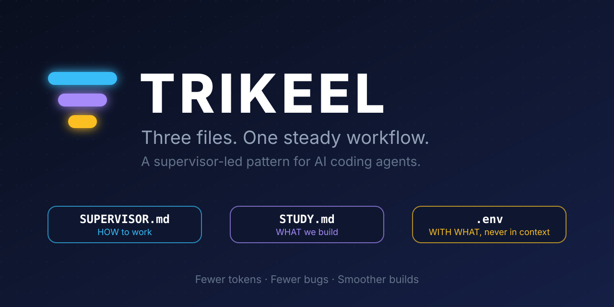
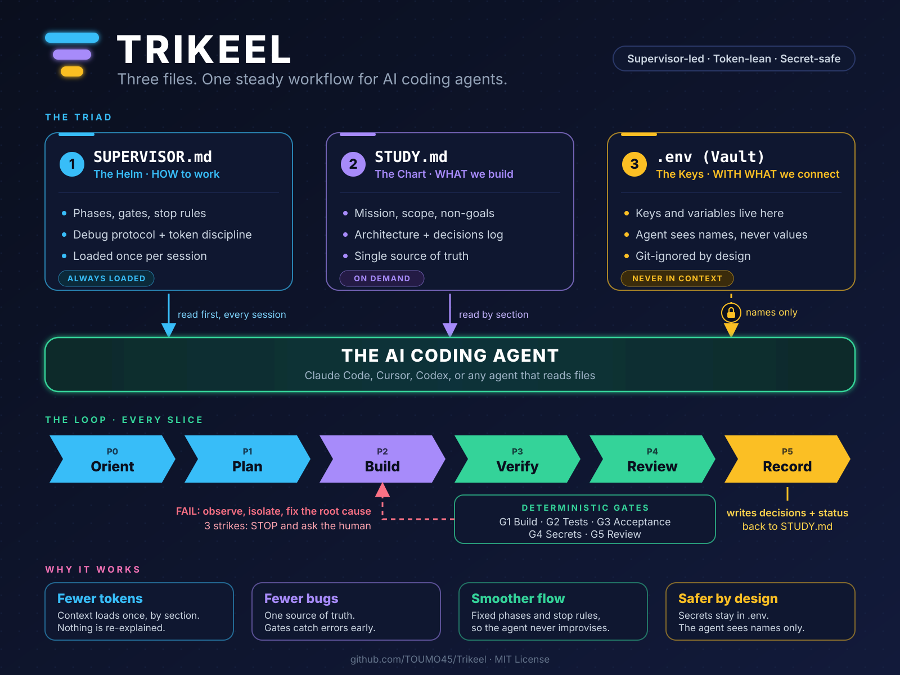

<div align="center">



<br>

[](LICENSE)
[](scripts/trikeel_check.py)
[](#use-it-with-your-agent)
[](CONTRIBUTING.md)

**Stop writing one giant prompt. Split it into three files with three jobs.**

[Quick start](#quick-start) · [The workflow](#the-workflow) · [Why it saves tokens](#why-it-saves-tokens) · [Measure it](docs/measure-it.md) · [Security](docs/security.md)

</div>

---

## The problem

Most AI-assisted builds go wrong in the same way. Rules, project context, edge cases and API keys all end up in **one huge prompt** that the agent has to re-read, re-interpret and eventually contradict.

- It **forgets constraints** halfway through a long session.
- It **re-explains the project** to itself on every turn and burns tokens doing it.
- It **improvises its own process**: skipping tests, drifting out of scope, "fixing" by trial and error.
- It **handles secrets carelessly** because credentials sit in the same context as everything else.

## The idea

Trikeel separates concerns. Three files, one job each:

| | File | Role | How the agent uses it |
|---|---|---|---|
| 🧭 | **`SUPERVISOR.md`**, the *Helm* | **HOW** to work: phases, gates, stop rules, debug protocol, token discipline | Read once at session start |
| 🗺️ | **`STUDY.md`**, the *Chart* | **WHAT** we build and **WHY**: mission, scope, architecture, decisions log | Read **by section**, on demand |
| 🔐 | **`.env`**, the *Vault* | **WITH WHAT** we connect: keys and variables | The agent sees **names only**, never values |

A keel is the part of a ship that keeps it steady and on course. That is the job: a stable agent that stays on the slice, proves its work, and does not leak secrets.

## The workflow

<div align="center">

</div>

<sub>Vector version: [`assets/trikeel-workflow.svg`](assets/trikeel-workflow.svg)</sub>

Every slice of work runs the same loop:

| Phase | Goal | Exit condition |
|---|---|---|
| **P0 Orient** | Understand the slice | Slice + acceptance check written down |
| **P1 Plan** | Smallest plan that could work | ≤ 10 steps, risks listed |
| **P2 Build** | Implement the slice | Runs locally |
| **P3 Verify** | Prove it works | Gates **G1–G4** pass |
| **P4 Review** | Attack your own diff | Gate **G5** passes |
| **P5 Record** | Write back to `STUDY.md` | Decision + status updated |

**Deterministic gates**

| Gate | Check |
|---|---|
| **G1 Build** | Project builds or starts cleanly |
| **G2 Tests** | Relevant tests pass; new behaviour has a test |
| **G3 Acceptance** | The slice's acceptance check is demonstrated with real output |
| **G4 Secrets** | No secret values in the diff; `.env` is untracked |
| **G5 Review** | Skeptical re-read: edge cases, error paths, scope creep |

**Stop rules.** The agent halts and asks a human before anything destructive, security-sensitive, scope-changing, blocked by a missing decision, or after **3 failed attempts** at the same gate. It reports: *Problem · What I tried · Options (with a pick) · What I need from you.*

## Quick start

```bash
# 1. Copy the three parts into your project
cp template/SUPERVISOR.md template/STUDY.md template/.env.example  your-project/
cp template/.gitignore your-project/.gitignore      # or merge it into yours

# 2. Create your Vault (never committed)
cd your-project && cp .env.example .env             # then fill in real values

# 3. Fill in STUDY.md: Mission, Goals, Non-goals, Architecture, Env contract

# 4. Point your agent at the Helm (see "Use it with your agent")

# 5. Validate the triad
python3 path/to/trikeel/scripts/trikeel_check.py .
```

Then give the agent one instruction: *"Follow SUPERVISOR.md. Start with P0 on the first slice in STUDY.md."*

## Why it saves tokens

This is a design argument, not a benchmark. The mechanisms are:

| Single mega-prompt | Trikeel |
|---|---|
| Rules, context and secrets re-sent and re-read together | Each concern loaded only when needed |
| Project context repeated in chat to "remind" the agent | Agent reads a **section** of `STUDY.md` instead |
| Progress tracked in conversation, then lost on a new session | Status and decisions persisted in `STUDY.md` |
| Agent invents its process each time | Fixed phases and gates: fewer wasted turns |
| Bugs found late, after many dependent edits | Gates catch them in the phase where they appear |
| Secrets in context, so one leaked log is a breach | Names only in context; values stay in `.env` |

The checker prints an approximate token footprint of the files loaded every session, so you can keep the Helm and the Chart lean:

```text
[5] Approx. token footprint (chars / 4)
        SUPERVISOR.md  ~ 1239 tokens
        STUDY.md       ~  591 tokens
        total          ~ 1830 tokens (loaded once per session)
```

> **Honest note.** Trikeel came out of a real build (Lomira), where the author saw a smoother workflow, fewer errors, less time and fewer tokens. That is one person's experience, **not a benchmark**. [`docs/measure-it.md`](docs/measure-it.md) gives you a simple A/B protocol to measure it on your own work.

## Use it with your agent

Trikeel needs no SDK. Any agent that reads files can follow it. Add one line to the instruction file your tool already reads:

| Tool | Where to add the line |
|---|---|
| Claude Code | `CLAUDE.md` |
| Codex and others | `AGENTS.md` |
| Cursor | `.cursor/rules` |
| Anything else | The first message of the session |

```markdown
Follow SUPERVISOR.md for how to work and STUDY.md for what to build.
Never read or print values from .env; use variable names only.
```

## The Vault rules

1. Real secrets live **only** in `.env`, which is git-ignored.
2. `.env.example` is committed, with names and placeholder values.
3. Every variable name appears in `STUDY.md` → **Env contract**.
4. The agent may reference names. It never prints, logs, commits or pastes values.
5. If a secret ever reaches a commit, **rotate it**. Deleting the commit is not enough.

Read [`docs/security.md`](docs/security.md) for the threat model and the limits of what the checker can catch.

## `trikeel-check`

A zero-dependency Python script that validates the triad.

```bash
python3 scripts/trikeel_check.py .            # report
python3 scripts/trikeel_check.py . --strict   # warnings fail too (good for CI)
```

It verifies that:

- all three parts exist,
- `.gitignore` covers `.env` and `.env` is not tracked by git,
- the **Env contract** in `STUDY.md` matches `.env.example`,
- no credential-looking strings sit in the Helm, the Chart or the example,
- the token footprint of the always-loaded files stays visible.

A failing run looks like this:

```text
[2] Vault hygiene
  FAIL  no .gitignore (the Vault must be ignored)
[4] Secret scan (Supervisor, Study, example)
  FAIL  STUDY.md: looks like a OpenAI/Anthropic-style key
Result: 2 failure(s), 0 warning(s)
```

## Repository layout

```text
trikeel/
├── template/            ← copy this into your project
│   ├── SUPERVISOR.md       the Helm: HOW to work
│   ├── STUDY.md            the Chart: WHAT to build
│   ├── .env.example        the Vault contract (names only)
│   └── .gitignore
├── examples/
│   └── invoice-reminder/   a filled-in example triad
├── scripts/
│   └── trikeel_check.py    validator (stdlib only)
├── docs/
│   ├── why-trikeel.md      design rationale
│   ├── measure-it.md       A/B protocol to measure your own gains
│   └── security.md         Vault threat model
└── assets/                 infographic and social preview (SVG + PNG)
```

## FAQ

**Is this a framework?** No. It is a pattern plus a template and a linter. There is nothing to install.

**Why not put everything in `CLAUDE.md` / `AGENTS.md`?** You can point those files at Trikeel. The point is separation: process, project truth and secrets change at different speeds and carry different risks.

**Does `STUDY.md` grow forever?** It should not. The Supervisor prunes stale status and keeps the Decisions log, which is the part that prevents the agent from re-litigating old choices.

**Can a prompt-only rule really protect secrets?** It reduces exposure; it is not a security boundary. Use a real secret manager in production and read [`docs/security.md`](docs/security.md).

## Roadmap

- [ ] `trikeel init` scaffolder
- [ ] More worked examples (web app, data pipeline, security tooling)
- [ ] Adapters for popular agent instruction formats
- [ ] Optional per-slice token logging helper for [`measure-it`](docs/measure-it.md)

Ideas and PRs are welcome. See [CONTRIBUTING.md](CONTRIBUTING.md).

## License

[MIT](LICENSE) © 2026 Kamari

<div align="center">
<sub>Don't make the AI smarter. Make its keel steadier.</sub>
</div>
